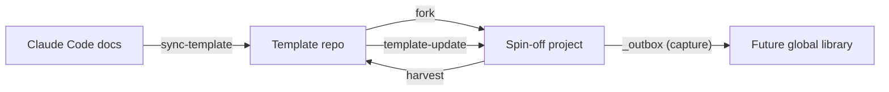

# Understanding Repositories, Branches, Environments & Claude Code

A plain-English guide for anyone new to modern software development workflows.

---

## The Big Picture

Think of the whole system like a construction project:

| Real world | Software equivalent |
|---|---|
| The blueprints (master set, kept safe) | **Repository (repo)** |
| Working copies handed to each trade | **Branches** |
| The actual building at different stages (model home, under construction, finished) | **Environments** |
| Inspection before changes go into the master blueprints | **Pull Request** |
| The foreman reviewing changes | **CI/CD pipeline** |
| An AI assistant who can read the blueprints and suggest edits | **Claude Code** |

---

## 1. The Repository

### What it is

A repository is a folder that Git watches. It stores:
- Every file in your project
- The **complete history** of every change ever made (who changed what, when, and why)
- All branches (parallel versions) of the work

It lives in two places simultaneously:
- **Remote** — on GitHub (the shared, authoritative copy everyone pulls from)
- **Local** — on your own machine (your personal working copy)

### Does a repo contain only one project?

**Usually yes.** The general rule:

| Pattern | Description | When to use |
|---|---|---|
| One repo = one project | Each project lives in its own repo | Most situations — keep things simple |
| Monorepo | Multiple related projects share one repo | When projects are tightly coupled and always change together |
| Polyrepo | One product split across many repos | Large organisations with independent teams per service |

For most solo or small-team work: **one repo per project**. It's cleaner, easier to manage, and easier to give Claude context about.

### What lives in a repo

```
my-project/
├── .claude/              ← Claude Code configuration
│   ├── commands/         ← Custom slash commands (team-shared)
│   ├── skills/           ← Skills (newer command format, team-shared)
│   ├── hooks/            ← Hook scripts (session-start, etc.)
│   ├── rules/            ← Topic-specific instructions for Claude
│   ├── .gitignore        ← Excludes personal/local Claude files
│   └── settings.json     ← Permissions and hooks
├── .github/              ← GitHub-specific config (Actions, PR templates)
├── assets/               ← Images, screenshots, binary files
├── docs/                 ← Documentation
├── src/                  ← Source code
├── .gitattributes        ← Tells Git how to handle different file types
├── .gitignore            ← Files Git should never track (secrets, build output)
├── .mcp.json             ← Project-scoped MCP server config (no secrets)
├── CLAUDE.md             ← Instructions for Claude — what to do, how to behave
├── CLAUDE.local.md       ← Personal Claude instructions (gitignored)
└── README.md             ← Human-readable project overview
```

### Ground rules for repositories

- Never commit secrets, credentials, API keys, or passwords — once in history, always in history
- Always have a `.gitignore` — keep build artifacts, logs, and local config out
- `main` (or `master`) is sacred — it must always be in a working state
- Write meaningful commit messages — future you (and Claude) will thank you
- Keep the `README.md` current — it is the front door to the project

---

## 2. Branches

### What they are

A branch is an **isolated copy of the codebase** where you can freely make changes without affecting anything else. When you are happy with the changes, you merge the branch back.

Visualised:

```
main    ●─────────────────────────────●─── (always stable)
         \                           /
          ●──●──●  feature/login  ──●      (your work)
```

The moment you create a branch, you get a full copy to work in. Changes on your branch are invisible to everyone else until you merge.

### Types of branches

| Branch name | Purpose | Lifetime |
|---|---|---|
| `main` / `master` | Production-ready, always deployable | Permanent |
| `develop` | Integration — collects features before going to main | Permanent (in git-flow) |
| `feature/<name>` | New functionality | Short-lived — deleted after merge |
| `fix/<name>` | Bug fixes | Short-lived — deleted after merge |
| `release/<version>` | Finalising a release, last-minute fixes only | Short-lived |
| `claude/<task-id>` | AI-assisted work (your CLAUDE.md convention) | Short-lived — deleted after merge |

### Ground rules for branches

- **Never commit directly to `main`** — always work on a branch, then open a Pull Request
- One branch = one concern (one feature OR one bug — never both)
- Branch names should be lowercase, hyphen-separated, and descriptive: `feature/user-auth` not `wims-branch`
- Keep branches short-lived — the longer they live, the harder they are to merge
- Delete branches after they are merged — a clean repo is an understandable repo
- Never force-push to a shared branch — it rewrites history others rely on

---

## 3. Environments

### What they are

An environment is a **running, deployed instance of your application** — configured for a specific audience or purpose. The code is the same; the configuration is different.

Think of it as the same recipe cooked in three different kitchens:
- One kitchen where the chef experiments freely (development)
- One kitchen that mirrors the restaurant exactly, for a dress rehearsal (staging)
- The actual restaurant kitchen serving real guests (production)

### The standard three environments

| Environment | Audience | Data | Stability | Purpose |
|---|---|---|---|---|
| **Development** | Developer / Claude | Fake or sample data | Can break freely | Build and test new things |
| **Staging** | QA, stakeholders | Anonymised copy of real data | Should be stable | Final check before going live |
| **Production** | Real users | Real data | Must never break | The live system |

### What differs between environments

The code is identical. What changes:
- Database connection strings
- API keys and credentials (each environment has its own — never shared)
- Feature flags (a feature may be on in dev but off in prod)
- URLs and hostnames
- Logging level (verbose in dev, minimal in prod)

### How environments connect to branches

```
Branch: main       →  deploys to  →  Production
Branch: develop    →  deploys to  →  Staging
Branch: feature/*  →  deploys to  →  Development (preview)
```

This is automated via CI/CD (see below) — you push code, the pipeline does the rest.

### Ground rules for environments

- Never use real user data in development
- Never share secrets between environments — each has its own
- Staging must mirror production as closely as possible; surprises in staging are good, surprises in production are not
- Only deploy to production via the automated pipeline — never manually push to prod
- Store secrets in GitHub's Secrets/Variables store, not in files in the repo

---

## 4. Pull Requests (PRs)

A Pull Request is a **formal request to merge one branch into another**. It is the gating mechanism between your work and the shared codebase.

A PR gives you:
- A place for code review (human or automated)
- A record of why the change was made (linked to an issue, written description)
- Automated test runs before anything merges
- The ability to request changes, approve, or block

### The lifecycle

```
1. You create a branch
2. You make commits
3. You push the branch and open a PR
4. CI runs tests automatically
5. Reviewer (or Claude, or an automated tool) reviews
6. Changes requested → you fix → CI runs again
7. Approved → merged → branch deleted
```

### Ground rules for PRs

- One PR = one concern — small, focused PRs are easier to review and safer to merge
- Write a clear description: what changed and *why*, not just *what*
- Link the PR to the issue it resolves
- Never merge your own PR on a team project without a second set of eyes

---

## 5. CI/CD — Your Automated Safety Net

CI/CD stands for **Continuous Integration / Continuous Deployment**.

- **CI (Continuous Integration):** Every time code is pushed, automated tests run. If they fail, the PR cannot merge. This catches mistakes before they reach main.
- **CD (Continuous Deployment):** When code merges to a branch, it automatically deploys to the corresponding environment.

For your template: CI runs tests → if green, merge allowed → merge triggers deploy.

```
Push to branch
      ↓
GitHub Actions runs tests
      ↓
  Pass? ──Yes──→ PR can be merged ──→ Merge ──→ Auto-deploy to environment
  Fail? ──No───→ PR blocked, fix required
```

---

## 6. Claude Code — Three Ways to Work

Claude Code is Anthropic's AI coding assistant. It can read your entire codebase, write and edit files, run terminal commands, and interact with GitHub. It runs in three modes — each suited to different needs.

### Mode 1: Claude Code Web (claude.ai)

**What it is:** Claude running in your browser, connected to a GitHub repository. Claude can read files, write code, create commits, and open PRs — all without you needing anything installed locally.

**Best for:**
- Working from any device (no local setup needed)
- Reviewing and discussing code
- Making targeted changes when you do not need local tools
- Getting started quickly

**Limitations:**
- Cannot access files on your local machine
- MCP servers are limited to remote/API-based ones
- Less suitable for running local scripts, PowerShell commands, or accessing network drives

**How it connects to the repo:** You authorise Claude to access your GitHub account. It clones the repo into a sandboxed environment for the session.

---

### Mode 2: Claude Code CLI (Terminal)

**What it is:** Claude running in your local terminal, inside your project directory. It has full access to your machine — files, commands, installed tools, network drives.

**Best for:**
- Running local scripts (PowerShell, Bash)
- Accessing local files not in the repo (logs, configs, network shares)
- Using MCP servers that talk to local services
- Building and testing locally before pushing

**How it connects to the repo:** You navigate to your locally cloned repo folder and run `claude`. It reads `CLAUDE.md` and `.claude/settings.json` from the folder.

---

### Mode 3: VSCode Extension

**What it is:** Claude embedded inside VSCode, working in the context of your open workspace. Best of both worlds — full local access plus tight IDE integration.

**Best for:**
- Active development sessions (editing multiple files, navigating code)
- Seeing changes in real time in the editor
- Debugging with IDE tools alongside Claude
- All the same local capabilities as CLI, plus editor integration

**How it connects to the repo:** VSCode has the repo open as a workspace. The extension reads the same `.claude/` config and `CLAUDE.md` as the CLI.

---

### Comparing the three modes

| | Web | CLI | VSCode |
|---|---|---|---|
| Needs local install | No | Yes (Claude Code CLI) | Yes (VSCode + Extension) |
| Access to local files | No | Yes | Yes |
| Access to local scripts | No | Yes | Yes |
| MCP servers (local) | No | Yes | Yes |
| MCP servers (remote/API) | Yes | Yes | Yes |
| GitHub integration | Yes (via OAuth) | Yes (via git + MCP) | Yes (via git + MCP) |
| Real-time editor view | No | No | Yes |
| Best for | Quick tasks, any device | Scripting, local files | Active development |

**Key insight:** All three modes read the same `CLAUDE.md` and `.claude/settings.json` — so Claude behaves consistently regardless of which mode you use. The configuration is in the repo, not tied to a machine.

---

## 7. CLAUDE.md — Your AI Constitution

`CLAUDE.md` is a plain-text file at the root of your repo. Every time Claude starts a session — Web, CLI, or VSCode — it reads this file first.

It tells Claude:
- What the project is and what it does
- How to name branches and write commit messages
- What to do and what not to do
- Project-specific conventions (folder structure, tools used, commands to run tests)
- Anything Claude should always remember

Think of it as standing instructions you write once and do not have to repeat in every conversation.

### CLAUDE.local.md — Personal Instructions

`CLAUDE.local.md` sits next to `CLAUDE.md` at the repo root but is **gitignored** — it never gets committed. Use it for personal preferences that should not apply to the whole team:

- Your preferred coding style nuances
- Paths to local tools or scripts on your machine
- Reminders specific to your workflow

Claude reads both files — `CLAUDE.md` first (shared), then `CLAUDE.local.md` (personal override).

### Auto Memory — What Claude Remembers on Its Own

Claude also maintains its own memory automatically, without you writing anything. As it works, it saves notes about your project: build commands it discovers, debugging patterns, preferences you correct. These live in `~/.claude/projects/<repo>/memory/` on your local machine and are loaded at the start of every session.

You do not need to set anything up — auto memory is on by default. Run `/memory` inside any Claude Code session to see every instruction file that is loaded, browse what Claude has saved, and toggle auto memory on or off.

Auto memory is machine-local. It is not shared with your team and not committed to the repo. Think of it as Claude's personal scratchpad for each project on your machine.

---

## 8. Commands and Skills — Reusable Slash Commands

### What they are

Commands and skills are files in `.claude/` that become `/slash-commands` inside any Claude Code session. They are prompt templates — when you type `/review-code`, Claude loads the corresponding file as its instruction.

**They are not cloud-based or account-level.** They are plain files in your repo, committed to Git, shared with anyone who clones the project.

### Commands — the simple format

Place Markdown files in `.claude/commands/`:

```
.claude/commands/
├── review-code.md       →  /review-code
├── commit-message.md    →  /commit-message
└── explain-function.md  →  /explain-function
```

Each `.md` file contains the prompt Claude will follow when the command is invoked. You can include:
- Specific instructions and constraints
- Output format requirements
- References to files or patterns Claude should look at

Subfolders are supported — `.claude/commands/deploy/pre-check.md` becomes `/deploy:pre-check` (colon separator, not slash).

### Skills — the newer format

Skills live in `.claude/skills/<name>/SKILL.md` and create the same `/name` command, but add optional capabilities:
- **YAML frontmatter** — control argument passing, auto-invocation (Claude decides when the skill is relevant without you typing the command)
- **Supporting files** — templates, scripts, or examples in the same directory that the skill can reference
- **Subagent execution** — the skill can spin up a subagent to handle the work

The template uses the simpler commands format, which continues to work. If you outgrow flat command files, see the [skills documentation](https://code.claude.com/docs/en/skills).

### Project vs personal commands

| Location | Scope | Committed? |
|---|---|---|
| `.claude/commands/` (in repo) | Everyone on the project | Yes |
| `.claude/skills/` (in repo) | Everyone on the project | Yes |
| `~/.claude/commands/` (home dir) | All your projects on this machine | No |

---

## 9. Rules — Topic-Specific Instructions

### What they are

Rules are Markdown files in `.claude/rules/` that give Claude topic-specific instructions. They work like `CLAUDE.md` but are split into separate files by concern — easier to maintain as a project grows.

```
.claude/rules/
├── code-style.md        ← Indentation, naming, simplicity
├── security.md          ← Input validation, secrets, OWASP
└── testing.md           ← Test patterns, coverage expectations
```

Claude reads all rule files at the start of every session, alongside `CLAUDE.md`. Rules can also be scoped to specific file paths using YAML frontmatter — for example, a rule that only applies when editing files in `src/api/`.

### When to use rules vs CLAUDE.md

| Use | For |
|---|---|
| `CLAUDE.md` | High-level project context, workflow, branch naming, commands |
| `.claude/rules/` | Specific technical standards — style, security, testing, etc. |

Think of `CLAUDE.md` as the overview and `.claude/rules/` as the detailed policies.

---

## 10. Local Configuration — Personal Overrides

Claude Code has a layered configuration system. Settings merge from multiple levels, with more specific scopes overriding broader ones:

| File | Scope | Committed? | Purpose |
|---|---|---|---|
| `~/.claude/settings.json` | All projects on this machine | No | Global defaults and preferences |
| `~/.claude.json` | All projects on this machine | No | Personal MCP server config (with secrets) |
| `~/.claude/CLAUDE.md` | All projects on this machine | No | Global instructions |
| `.mcp.json` | This project (everyone) | Yes | Project MCP server config (no secrets) |
| `.claude/settings.json` | This project (everyone) | Yes | Team permissions and hooks |
| `.claude/settings.local.json` | This project (just you) | No | Personal permission overrides |
| `CLAUDE.md` | This project (everyone) | Yes | Team instructions |
| `CLAUDE.local.md` | This project (just you) | No | Personal instructions |

**Key insight:** The `.gitignore` excludes `CLAUDE.local.md` and `.claude/settings.local.json` so your personal preferences never leak into the shared repo. The `.claude/.gitignore` does the same for files inside the `.claude/` directory.

---

## 11. MCP Servers — Extending Claude's Reach

MCP (Model Context Protocol) servers are plugins that give Claude access to external systems beyond the codebase.

| MCP Server | What it gives Claude access to |
|---|---|
| `filesystem` | Local files and folders on your machine |
| `github` | GitHub API — issues, PRs, repos, metadata |
| `postgres` / `sqlite` | Databases |
| `slack` | Slack messages and channels |
| Custom | Any internal tool or API you build |

MCP servers run locally (for CLI and VSCode) or remotely (for Web). They are configured in `.mcp.json` at the repo root (project-scoped, committed to Git — no secrets), or globally in `~/.claude.json` on your machine (user-scoped, not committed). Never put tokens or credentials in `.mcp.json`; store those in the user-level config or your machine's credential manager.

---

## 12. Hooks — Ambient Automation

### What they are

Hooks are shell commands, scripts, or prompts that Claude Code runs automatically when specific events occur in a session. They are configured in `.claude/settings.json` under the `"hooks"` key, or in your user-global `~/.claude/settings.json`.

Hooks are **not** for AI logic — use commands and skills for that. They are ambient infrastructure: startup setup, logging, sound notifications, lightweight guardrails.

This template already uses one hook: `SessionStart` runs `.claude/hooks/session-start.sh` to print git status and context at the beginning of every session.

### The hook events (as of July 2026)

Grouped by what they react to. Source: the [hooks reference](https://code.claude.com/docs/en/hooks).

**Session lifecycle**

| Event | When it fires |
|---|---|
| `Setup` | On `--init-only`, or `--init` / `--maintenance` in `-p` mode |
| `SessionStart` | When a session begins or resumes |
| `SessionEnd` | When a session terminates |
| `InstructionsLoaded` | When a `CLAUDE.md` or `.claude/rules/*.md` file is loaded into context |
| `ConfigChange` | When a configuration file changes during a session |
| `CwdChanged` | When the working directory changes |
| `DirectoryAdded` | After `/add-dir` or the SDK `register_repo_root` (added v2.1.220) |
| `FileChanged` | When a watched file changes on disk |

**Prompts and messages**

| Event | When it fires |
|---|---|
| `UserPromptSubmit` | When you submit a prompt, before Claude processes it |
| `UserPromptExpansion` | When a typed command expands into a prompt, before it reaches Claude |
| `MessageDisplay` | While assistant message text is displayed |
| `Stop` | When Claude finishes responding |
| `StopFailure` | When the turn ends due to an API error |

**Tool calls and permissions**

| Event | When it fires |
|---|---|
| `PreToolUse` | Before a tool call executes — can allow or deny it |
| `PermissionRequest` | When a tool call needs a permission decision |
| `PermissionDenied` | When a tool call is denied by the auto mode classifier |
| `PostToolUse` | After a tool call succeeds |
| `PostToolUseFailure` | After a tool call fails |
| `PostToolBatch` | After a full batch of parallel tool calls resolves |
| `Notification` | When Claude Code sends a notification |

**Subagents, tasks, and worktrees**

| Event | When it fires |
|---|---|
| `SubagentStart` | When a subagent is spawned |
| `SubagentStop` | When a subagent finishes |
| `TaskCreated` | When a task is being created via `TaskCreate` |
| `TaskCompleted` | When a task is being marked complete |
| `TeammateIdle` | When an agent team teammate is about to go idle |
| `WorktreeCreate` | When a worktree is being created |
| `WorktreeRemove` | When a worktree is being removed |

**Context and MCP**

| Event | When it fires |
|---|---|
| `PreCompact` | Before context compaction runs |
| `PostCompact` | After context compaction completes |
| `Elicitation` | When an MCP server requests user input during a tool call |
| `ElicitationResult` | After a user responds to an MCP elicitation |

### Hook types

| Type | Description |
|---|---|
| `command` | Runs a shell command |
| `prompt` | Sends a prompt to Claude |
| `agent` | Spins up a subagent |
| `http` | Makes an HTTP request (added v2.1.63) |
| `mcp_tool` | Calls an MCP tool |

Most events accept all five types. `SessionStart` and `Setup` are the exception — they
support only `command` and `mcp_tool`.

### When to use hooks

- `Setup` / `SessionStart` — print branch/git context, validate environment (this template uses `SessionStart`)
- `PreToolUse` — log or restrict tool calls, enforce guardrails
- `PostToolUse` — audit trail of what Claude did
- `Stop` / `SessionEnd` — cleanup or notifications

---

## 13. Sandboxing — Containing What Claude Can Reach

### What it is

Sandboxing puts OS-level limits on the commands Claude runs, independently of the
permission system. Permissions decide *whether* a command is allowed to start;
the sandbox decides *what that command can touch* once it is running.

The two layers answer different questions, so they are worth having together:

| Layer | Question it answers | Where configured |
|---|---|---|
| Permissions (`allow` / `ask` / `deny`) | Should this tool call happen at all? | `.claude/settings.json` |
| `PreToolUse` hook | Does this specific invocation look dangerous? | `.claude/hooks/pre-tool-use.sh` |
| Sandbox | What filesystem and network can the running command see? | `/sandbox`, `sandbox.*` settings |

A `deny` rule stops `curl https://evil.example`. The sandbox stops a command you
*did* approve from quietly reaching a host you never intended.

### Turning it on

Run `/sandbox` in a session. It applies to bash commands for that session.

Reach for it when working with external web services, untrusted content, or
unfamiliar dependencies — anything where a command might do more than it says.

### Settings

| Key | What it does |
|---|---|
| `sandbox.network.strictAllowlist` | Denies any host not on the allowlist, rather than allowing by default (added v2.1.220) |
| `sandbox.filesystem.disabled` | Skips filesystem isolation while keeping network control (added v2.1.216) |
| `sandbox.allowAppleEvents` | Lets sandboxed commands send Apple Events on macOS (added v2.1.181) |
| `sandbox.credentials` | Controls which credential files and env vars reach the sandbox. **Managed settings only** — cannot be set in a project or user settings file (added v2.1.191) |

This template does not enable sandboxing by default. Turning it on changes how
every bash command behaves, and the right allowlist is project-specific — so it is
a deliberate per-project choice rather than a template default.

---

## 14. GitHub Security — Is a Private Repo Safe?

### What "private" actually means

A private repository means no one can see it on the internet without being explicitly granted access. GitHub enforces this at the platform level. However, **"private" is not the same as "impenetrable."** The threats are almost never GitHub itself — they are the humans and tokens connected to it.

### The real threat surface

| Threat | Risk | How it happens |
|---|---|---|
| **Committed secrets** | High | A token, password, or API key gets pushed in a file — even once, it is in history forever |
| **Compromised account** | High | Weak password with no MFA means full access to all repos for an attacker |
| **Stolen Personal Access Token** | High | A PAT stored carelessly (in a script, chat, or `.env` file) is leaked |
| **Over-permissioned collaborators** | Medium | Too many people with write access, or access not revoked when someone leaves |
| **Dependency/supply chain attack** | Medium | A package your code uses is compromised — unrelated to GitHub's own security |
| **GitHub itself being breached** | Very low | Has happened in limited scope historically; Microsoft invests heavily in prevention |
| **Accidental public visibility** | Low | Repo accidentally set to public, or a fork is public when the parent is private |

### The one rule that matters most

> **Enable two-factor authentication (2FA) or a passkey on your GitHub account.**
>
> If your account is protected by only a password, everything else is irrelevant. A stolen password gives an attacker full control of every repo, every secret, every environment. 2FA blocks this completely. It takes two minutes and eliminates the single biggest realistic attack vector.
>
> GitHub → Settings → Password and authentication → Enable 2FA or add a passkey.

### GitHub's built-in security features

| Feature | What it does | Where to enable |
|---|---|---|
| **2FA / Passkeys** | Blocks account takeover even if your password leaks | Settings → Password and authentication |
| **Secret scanning** | Detects accidentally committed tokens/keys and alerts you (or blocks the push) | Settings → Code security → Secret scanning |
| **Push protection** | Blocks a push outright if it contains a known secret pattern — stops the mistake before it lands | Settings → Code security → Push protection |
| **Dependabot** | Scans dependencies for known vulnerabilities, opens PRs to update them | Settings → Code security → Dependabot |
| **Code scanning** | Static analysis — catches security bugs in your code | Settings → Code security → Code scanning |
| **Fine-grained PATs** | Scoped to one repo, one permission set, with an expiry date — safer than classic tokens | Settings → Developer settings → Personal access tokens → Fine-grained |
| **Branch protection** | Prevents force-pushes and direct commits that could overwrite history | Repository → Settings → Branches |
| **Audit log** | Records every action — who pushed what, when, from where | Organisation → Settings → Audit log |

### The honest bottom line

A private GitHub repo is very safe if you use it correctly. The platform itself is hardened by Microsoft-level security investment. The realistic risk is almost always your own practices: committed secrets, no MFA, or tokens stored carelessly. Enable MFA, never commit secrets, use GitHub Secrets for credentials, and your exposure is minimal.

---

## 15. How Everything Ties Together

```
┌─────────────────────────────────────────────────────────────────┐
│                        GitHub (remote)                          │
│                                                                 │
│   Repository: my-project                                        │
│   ├── Branch: main ──────────────── Environment: Production    │
│   ├── Branch: develop ────────────── Environment: Staging      │
│   └── Branch: feature/xyz ────────── Environment: Dev/Preview  │
│                        ↑                                        │
│              Pull Requests gate every merge                     │
│              CI/CD runs on every push                           │
└─────────────────────────────────────────────────────────────────┘
         ↑ git push / pull ↑
┌────────────────────────────────────┐
│         Your Local Machine         │
│                                    │
│   /projects/my-project/            │
│   (clone of the GitHub repo)       │
│                                    │
│   ┌──────────┐  ┌───────────────┐  │
│   │Claude CLI│  │VSCode+        │  │
│   │(terminal)│  │Claude Extension│ │
│   └──────────┘  └───────────────┘  │
│        ↑ reads ↑                   │
│   CLAUDE.md                        │
│   .claude/settings.json            │
│   .claude/commands/                │
│   .claude/rules/                   │
└────────────────────────────────────┘
         +
┌────────────────────────────────────┐
│   claude.ai (Web)                  │
│   Connected to GitHub via OAuth    │
│   Reads same CLAUDE.md             │
│   No local file access             │
└────────────────────────────────────┘
```

### The daily workflow loop

```
1. Pull latest changes from main
2. Create a new branch (Claude does this automatically for tasks)
3. Work with Claude (Web / CLI / VSCode — your choice)
4. Claude commits changes to the branch
5. Push branch to GitHub
6. Open Pull Request
7. CI runs tests
8. Review and merge
9. Branch deploys to the appropriate environment
10. Delete the branch
11. Back to step 1
```

---

## 16. Best Practices — All Together

### Repository
- One repo per project unless there is a strong reason for a monorepo
- `README.md` always explains what the project is and how to run it
- `CLAUDE.md` always explains how Claude should behave
- No secrets ever — use GitHub Secrets for credentials
- `.gitignore` from day one

### Branches
- `main` is always deployable — protect it with branch protection rules
- Every change goes through a branch + PR, no exceptions
- Keep branches short-lived and focused on one thing
- Name branches clearly: `feature/`, `fix/`, `claude/`

### Environments
- Three environments minimum: dev, staging, production
- Each environment has its own secrets — never shared
- Staging must look like production
- Only CI/CD deploys to production — no manual deploys

### Security
- Enable 2FA or a passkey on your GitHub account — do this before anything else
- Enable secret scanning and push protection on every repo (Settings → Code security)
- Enable Dependabot on every repo — it catches vulnerable dependencies automatically
- Never commit secrets, tokens, or credentials — use GitHub Secrets for all credentials
- Use fine-grained Personal Access Tokens scoped to one repo with an expiry date
- Store tokens in a password manager or Windows Credential Manager — never in plain text files
- Revoke access tokens when a project ends or a collaborator leaves

### Claude Code
- Keep `CLAUDE.md` updated — it is Claude's memory across sessions
- Use `.claude/rules/` for detailed technical standards (style, security, testing)
- Use `.claude/commands/` for reusable slash commands the whole team can use; use `.claude/skills/` for commands that need auto-invocation, arguments, or supporting files
- Use `CLAUDE.local.md` for personal preferences that should not be shared
- Use CLI or VSCode when you need local file/script access
- Use Web when you are away from your main machine or for quick discussions
- MCP servers extend what Claude can reach — add only what you actually need
- Let Claude manage branches and commits — it follows your `CLAUDE.md` conventions automatically
- Use hooks for ambient automation (startup context, logging, notifications) — not for AI control flow
- Turn on `/sandbox` when working with external services or untrusted content — permissions gate whether a command runs, the sandbox limits what it can reach
- Run `/sync-template` periodically to review the Claude Code changelog and keep this template current

## 17. The Template Feedback Loop

A template is only useful if it stays current. Four mechanisms keep knowledge flowing in the right directions:



### sync-template (inbound)

The `/sync-template` skill fetches Claude Code release notes and compares them against template files. When Claude Code ships new features, deprecations, or best-practice changes, the skill identifies gaps and proposes updates. The weekly `claude-docs-watch.yml` GitHub Action monitors for doc changes and opens an issue when they're detected, prompting a `/sync-template` run.

Direction: external Claude Code docs into the template.

### _outbox (capture)

During normal project work, reusable code snippets and patterns are saved to `_outbox/` following the rules in `.claude/rules/outbox-capture.md`. This is a per-project staging area. A future global library harvester will sweep across projects to collect and index these snippets.

Direction: project work into a cross-project library.

### harvest (spin-off to template)

When the template is forked into a real project, that project evolves — new rules, skills, documentation sections, structural patterns. The `/harvest` skill audits the spin-off for concepts worth transferring back. It produces paste-prompts (self-contained text blocks the user pastes into a Claude session in the template repo) so transfer requires no cross-repo git operations.

The `/harvest flag` subcommand and the `harvest-flag.md` rule enable conversational bookmarking during normal work. When you say "save this for the template" or similar, Claude appends an entry to the harvest queue. The next `/harvest audit` picks it up alongside diff-discovered changes.

Direction: spin-off project back into the template.

### template-update (template to spin-off)

A spin-off does not receive template changes by itself. The `/template-update` skill, run in the spin-off, lists the template pull requests merged since the last sync and decides per file: take the template's file as is, merge the change into the spin-off's own version, or skip it. Each template PR states what spin-offs need in its **Downstream (spinoffs)** section. The skill records the last synced commit and any deferred or declined items in `.claude/template-baseline.md`, which `/harvest` also uses so it does not offer synced template changes back. A read-only `status` mode, run in the template, shows which spin-offs are behind. Step-by-step manual: `docs/runbooks/template-update.md`.

Direction: template into spin-off projects.

### library (cross-project archive)

Harvest paste-prompts and implementation plans take real effort to produce but are ephemeral — they live in chat or get overwritten. The `/export-prompt` skill saves them to `C:\DEV\Claude\library\`, a project-independent folder that holds reusable building blocks across all projects: scripts, prompts, plans, and skill templates. One `.md` file per item, organized by type (`prompts/harvest/`, `prompts/skills/`, `plans/`, `scripts/<language>/`).

Direction: any project into a permanent cross-project library.

### Keeping it all in sync

After adding or removing commands, skills, rules, or structural directories, run `/consistency-check-docs` to verify that all index files (`.claude/README.md`, `CLAUDE.md`, `SETUP.md`, `CONTRIBUTING.md`, glossary) agree with each other and with the actual file tree. The skill reports mismatches as a checklist — it does not auto-fix.
