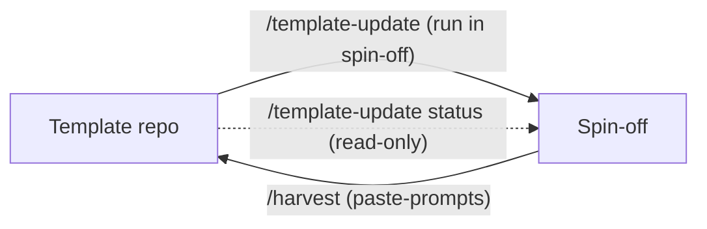

# Runbook: bring template changes into a spin-off

Audience: Developer
Last reviewed: 2026-11-17

## Overview

Projects created from this template (spin-offs) do not receive template changes by themselves. The `/template-update`
skill brings them in: it lists the template pull requests merged since the spin-off last synced, decides per file
whether to copy it, merge it by intent or skip it, applies what you approve on a branch, and records the new sync
state in the spin-off's `.claude/template-baseline.md`. A read-only status mode, run from the template, shows which
spin-offs are behind.

The opposite direction, spin-off learnings back into the template, is `/harvest`. The skill file is
[`.claude/skills/template-update/SKILL.md`](../../.claude/skills/template-update/SKILL.md); this runbook is the
human side of it.

## Prerequisites

- A local clone of the template, ideally a sibling of the spin-off folder (`<parent>\claude-code-template`). The skill
  reads template history from this clone, because a spin-off made with **Use this template** or by copying files has
  no template history of its own.
- GitHub CLI signed in with an account that can read the template repo (the skill reads each PR's
  **Downstream (spinoffs)** section). See the `SETUP.md` section "More than one GitHub account on one machine" if
  the spin-off and the template belong to different accounts.
- A clean working tree in the spin-off.

## How template PRs tell spin-offs what to do

Every template PR carries a **Downstream (spinoffs)** section with fixed labels. The skill reads them; PRs older
than that section get an inferred label, marked as such.

| Label | Meaning for the spin-off |
|---|---|
| Template-only | Nothing to do |
| Sync file | Take the template's file as is |
| Merge by intent | The spin-off has probably customised the file: apply the change, keep the customisation |
| One-time local action | Something to run or set in each spin-off clone, described on the `Action:` line |

Independently of the label, the skill checks each file itself by comparing three committed versions: the template's
file at the last sync, the template's current file, and the spin-off's file.

## Procedures

### Bootstrap a spin-off that does not have the skill yet

**When to use:** the first update of a spin-off created before `/template-update` existed.

**Steps:**
1. Make sure the template clone is up to date: in it, `git switch main` and `git pull`.
2. Open a Claude Code session **in the spin-off**.
3. Say: "Read and follow `<template clone>\.claude\skills\template-update\SKILL.md` to update this project from the
   template."
4. If the spin-off's baseline has no fork commit, Claude proposes one from the date of the spin-off's first commit.
   Check it before confirming: it should be the last template commit before the spin-off was created.
5. Continue as in the routine update below. The skill itself is one of the files the first sync brings in.

**Expected outcome:** a PR in the spin-off that adds the skill, the changes you approved, and a filled-in
**Sync state** section in `.claude/template-baseline.md`.

### Routine update

**When to use:** after template PRs merge that matter to spin-offs, or periodically.

**Steps:**
1. In the spin-off, run `/template-update` (add `--template <path>` if the clone is not a sibling folder).
2. Review the plan. It is grouped by category, one row per file with the PR it came from. For each row, approve,
   defer (proposed again next time) or decline (not proposed again).
3. For **Merge by intent** rows, read the merged result Claude shows you before it is staged.
4. For `.claude/settings.json`, apply the printed diff yourself, outside the session. If a deny rule changed, check
   that `.claude/hooks/pre-tool-use.sh` mirrors it.
5. Work through the **One-time local actions** checklist (see below).
6. Review and merge the spin-off PR the skill opens.

**Expected outcome:** the spin-off's **Last synced** points to the template's current `main`, and Deferred and
Declined list what was left out and why.

### Status overview from the template

**When to use:** to see which spin-offs are behind, without changing them.

**Steps:**
1. Open a Claude Code session in the template repo.
2. Run `/template-update status <spin-off path> <spin-off path> …`.

**Expected outcome:** one row per spin-off: last synced commit and date, PRs behind, deferred items, and PRs with a
one-time local action. Nothing in the spin-offs changes.

### One-time local actions

These are per clone or per machine and are never committed. Claude runs read-only checks and leaves anything that
changes git config or machine state to you. The actions from November 2026:

| From template PR | Check | Action if needed |
|---|---|---|
| #43 hook modes | `git ls-files -s .githooks .claude/hooks` shows `100755` for every hook | From Git Bash: `git ls-files .githooks .claude/hooks \| xargs git update-index --chmod=+x`, then commit |
| #42 two GitHub accounts | Only if this machine has two accounts: `git config --get-all credential.helper` shows the per-repo helper | Follow `SETUP.md`, "More than one GitHub account on one machine" |

## Worked example: template PRs #41 to #44

A spin-off created from template commit `afacff3`, with its own changes to `ci.yml` and `SETUP.md`, was put through
the skill on 2026-11-17 (a test spin-off, not a real project). Result:

| Template PR | Files | Category | Notes |
|---|---|---|---|
| #41 pre-commit self-match | `.githooks/pre-commit` | Sync file | Executable bit restored on apply |
| #42 two GitHub accounts | `SETUP.md` | Merge by intent | One-time local action only on two-account machines |
| #43 hook modes in CI | `.github/workflows/ci.yml`, `SETUP.md`, `docs/setup-guide.md` | Merge by intent (first two), Sync file (last) | `git merge-file` merged without conflicts and kept the spin-off's own test step and title |
| #44 `git fetch` false positive | `.claude/hooks/pre-tool-use.sh` | Sync file | — |

## Common failure modes

### `git fetch` is blocked in the spin-off
**Cause:** the spin-off's `pre-tool-use.sh` predates template PR #44.
**Resolution:** use `git pull` until #44 is synced. The skill already does.

### A commit or PR command is blocked as "External fetch command"
**Cause:** the hook blocks any command whose text contains `curl` or `wget`, including a heredoc commit message.
**Resolution:** write the message to a file and pass it with `git commit -F <file>` or `gh pr create --body-file <file>`.

### "Could not resolve to a Repository" or "not found" from `gh`
**Cause:** the active `gh` account cannot read the template repo.
**Resolution:** prefix the command with `GH_TOKEN=$(gh auth token -u <account>)`; see `SETUP.md`, "More than one
GitHub account on one machine".

### The base commit is not found
**Cause:** the baseline's fork commit or last-synced SHA is a placeholder, mistyped, or the template clone is out of
date.
**Resolution:** update the clone with `git pull`, then correct the SHA in `.claude/template-baseline.md`. Claude can
propose a fork commit from the spin-off's first commit date; confirm it, do not accept a guess.

### Changes to `.claude/settings.json` cannot be applied in the session
**Cause:** the `ConfigChange` hook blocks project-settings edits during a session, on purpose.
**Resolution:** apply the printed diff in an editor outside the session.

### `/harvest` offers template changes back to the template
**Cause:** the spin-off's baseline has no **Last synced** value, so `/harvest` compares against the fork commit.
**Resolution:** run `/template-update` once; it records **Last synced**, which `/harvest` then uses.

## Escalation

Stop and resolve by hand when a **Merge by intent** result does not make sense for the spin-off, or when a template
change conflicts with a deliberate spin-off decision. Decline it with a reason, so the decision is recorded in
**Declined** and not proposed again. If a template change is wrong for every spin-off, fix it in the template instead.
